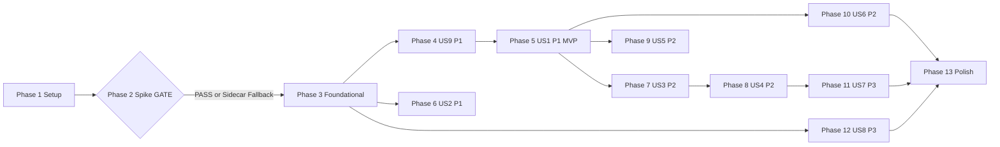

# Tasks: Retail POS System — 16-Store Supermarket Rollout

**Input**: Design documents from `/specs/001-retail-pos-mvp/`
**Prerequisites**: [plan.md](plan.md), [spec.md](spec.md), [research.md](research.md), [data-model.md](data-model.md), [contracts/](contracts/), [quickstart.md](quickstart.md)
**Constitution**: [.specify/memory/constitution.md](../../.specify/memory/constitution.md) v1.1.0

**Tests**: The spec calls out required test artefacts (pgTAP, PowerSync isolation, Vitest, WebDriverIO E2E). Test tasks are included per user story but are NOT strict TDD — implementation may land in the same PR as its tests. What the spec DOES require is that each user story's Independent Test scenario has an executable test task before that story's checkpoint is claimed.

**Organization**: Tasks are grouped by phase. Phases 1–3 are prerequisites; Phases 4–12 are per-user-story; Phase 13 is polish. Phase 2 (Phase 0a Spike) is a **BLOCKING GATE** — Phase 3+ MUST NOT begin until the spike report is written and its outcome (primary SDK or sidecar fallback per [research.md §12](research.md)) is recorded.

## Format: `[ID] [P?] [Story] Description`

- **[P]**: Can run in parallel (different files, no dependencies on incomplete tasks in the same phase)
- **[Story]**: `[US1]`…`[US9]` label; Setup/Foundational/Spike/Polish phases have no story label
- Every task specifies a concrete file path

## Path Conventions

Per [plan.md project structure](plan.md#project-structure): pnpm-workspaces monorepo. `apps/pos` (Windows Tauri POS), `apps/admin` (web admin), `supabase/` (migrations + Edge Functions), `powersync/` (sync rules), `packages/` (shared TS), `docs/ops/` (runbooks).

---

## Phase 1: Setup (Shared Infrastructure)

**Purpose**: Monorepo scaffolding, base tooling, and dependency install. Nothing here depends on the Phase 0a spike outcome.

- [X] T001 Create the monorepo directory tree per [plan.md](plan.md): `apps/pos/`, `apps/admin/`, `supabase/{migrations,functions,seed,tests}/`, `powersync/{tests/}`, `packages/{events,contracts,db-shared,config}/`, `docs/ops/`
- [X] T002 [P] Root workspace config: `package.json` (private, name `@hgl/monorepo`), `pnpm-workspace.yaml` listing `apps/*` and `packages/*`, `.gitignore` (Rust `target/`, Next `.next/`, Tauri build artefacts, `node_modules/`), `.editorconfig`
- [X] T003 [P] Shared TS config: `packages/config/tsconfig/base.json` (strict, ES2022, `moduleResolution: "bundler"`), `packages/config/tsconfig/react.json`, `packages/config/tsconfig/node.json`
- [X] T004 [P] Shared ESLint + Prettier: `packages/config/eslint/index.mjs`, `packages/config/prettier/index.mjs`
- [X] T005 [P] Init Supabase locally: run `supabase init`; commit `supabase/config.toml`; add `supabase/README.md` with local URLs contract
- [X] T006 [P] Install PowerSync CLI at dev-time; create `powersync/local.yaml` pointing at local Supabase; add PowerSync CLI check to CI
- [X] T007 CI baseline in `.github/workflows/ci.yml`: lint (all), typecheck (all), Vitest, pgTAP (`supabase test db`), PowerSync sync-rule tests, Tauri Windows build (matrix: `windows-latest`)
- [X] T008 [P] Scaffold `apps/pos`: Next.js 15 App Router with `output: "export"` in `apps/pos/next.config.mjs`; `apps/pos/package.json` extending shared config
- [X] T009 [P] Scaffold `apps/admin`: Next.js 15 App Router + Tailwind + shadcn/ui in `apps/admin/`; `apps/admin/next.config.mjs`; `apps/admin/tailwind.config.ts`
- [X] T010 [P] Scaffold `apps/pos/src-tauri/`: `tauri.conf.json` (WebView2 target, `tauri-plugin-updater`, code-signing config skeleton), `Cargo.toml`, `src/main.rs`, `build.rs`
- [X] T011 [P] Install PowerSync Tauri SDK (alpha — pinned version) and `@powersync/react` in `apps/pos/package.json`; add version pin comment referencing [research.md §1](research.md)
- [X] T012 [P] Install Supabase JS client v2 in both `apps/pos/package.json` and `apps/admin/package.json`
- [X] T013 [P] Install Zod + Drizzle ORM in `packages/events/package.json` and `packages/db-shared/package.json`
- [X] T014 [P] Bootstrap `packages/events/src/index.ts` by copying the Zod schemas from `contracts/events.schema.ts` verbatim; export types
- [X] T015 [P] Bootstrap `packages/contracts/src/http-api.ts` with request/response TS types matching [contracts/http-api.md](contracts/http-api.md)

**Checkpoint**: Monorepo installs cleanly (`pnpm install`), CI green on empty apps.

---

## Phase 2: Phase 0a Offline-Write Spike (BLOCKING GATE)

**Purpose**: Validate the alpha PowerSync Tauri SDK end-to-end before ANY foundational work is built on top. Documented in [research.md §12](research.md).

**⚠️ CRITICAL**: No Phase 3+ task may begin until T018 records a decision.

- [ ] T016 Implement the smallest offline-write slice on the real Tauri + PowerSync Tauri SDK: one seeded cashier, one shift open, one sale using cached prices, disconnect from WAN, reconnect, verify sync. Files: `apps/pos/src/app/spike/page.tsx` + `apps/pos/src-tauri/src/spike.rs`
- [ ] T017 Execute the four pass criteria in [research.md §12](research.md) on target Windows POS hardware: (a) no SDK crash under normal write load, (b) SQLite file survives an app-update install (not just restart), (c) IPC stable under repeat cycles, (d) no data loss under `kill -9` mid-write. Record raw evidence in `specs/001-retail-pos-mvp/spike-evidence/`
- [ ] T018 **GATE decision**: write `specs/001-retail-pos-mvp/spike-report.md` documenting PASS/FAIL per criterion and one of two outcomes:
  - **PASS** → Phase 3+ proceeds on the primary Tauri SDK path.
  - **FAIL** → apply the Tauri sidecar fallback per [research.md §12.1](research.md): add a Node.js sidecar binary to `apps/pos/src-tauri/tauri.conf.json > externalBin`, implement the `IDb` interface as a sidecar HTTP/IPC adapter in `apps/pos/src/lib/db/`, and update Phase 3+ tasks that reference "PowerSync Tauri SDK" to say "PowerSync SDK (sidecar)". Sidecar transport (loopback HTTP vs Tauri `invoke`) picked and justified in the report.

**Checkpoint** ⚠️: Spike report exists and outcome recorded. SC-012 met.

---

## Phase 3: Foundational (Blocking Prerequisites)

**Purpose**: Postgres schema, RLS, sync rules, sync-engine wiring, sync-health, auth infrastructure. Every user story depends on this phase. Some tasks reference "PowerSync Tauri SDK" — substitute "sidecar-hosted SDK" if the spike fell back.

### Postgres schema (data-model.md)

- [ ] T019 Migration `supabase/migrations/0001_master_data.sql`: `stores`, `tills`, `sku_categories`, `skus`, `sku_barcodes`, `store_sku_availability`, `suppliers`, `sku_suppliers`, `users`, `promotions`, `price_versions` (append-only per [data-model.md §1.7](data-model.md)) — no `superseded_by`, no `effective_to`
- [ ] T020 [P] Migration `supabase/migrations/0002_event_tables.sql`: `stock_events`, `sale_events`, `shift_events`, `transfer_events`, `adjustment_events`, `price_change_events` with common columns + `event_id` PK + `ON CONFLICT DO NOTHING` ingest per [data-model.md §2](data-model.md)
- [ ] T021 [P] Migration `supabase/migrations/0003_projection_tables.sql`: `current_stock_by_store_sku`, `shifts`, `sales`, `transfers`, `pending_transfer_receipts` (side table for out-of-order transfer_in per EC-04)
- [ ] T022 [P] Migration `supabase/migrations/0004_sync_health.sql`: `sync_health_snapshots`, `sync_health_alerts`
- [ ] T023 [P] Migration `supabase/migrations/0005_audit_log.sql`: `audit_log` + `public.append_audit(...)` SECURITY DEFINER function (write path for RLS-blocked table)
- [ ] T024 Migration `supabase/migrations/0006_projection_triggers.sql`: `AFTER INSERT` triggers on all six event tables to maintain projections. Transfer state machine implemented here — `transfer_received` arriving before `transfer_dispatched` is held in `pending_transfer_receipts` (EC-04)
- [ ] T025 Migration `supabase/migrations/0007_price_change_trigger.sql`: `AFTER INSERT` on `price_change_events` inserts a new `price_versions` row. No mutation of prior versions (see EC-19 canonical resolution query)
- [ ] T026 Migration `supabase/migrations/0008_indexes.sql`: all indexes from [data-model.md §6](data-model.md) — event tables `(store_id, server_ts DESC)`, `(till_id, server_ts DESC)`, `sale_events (cashier_id, server_ts DESC)`, `(sale_id) UNIQUE`, partial index on `current_stock_by_store_sku WHERE is_oversold`
- [ ] T027 Migration `supabase/migrations/0009_rls_policies.sql`: import [contracts/rls-policies.sql](contracts/rls-policies.sql) verbatim including `tg_validate_cashier_belongs_to_store()` triggers on `sale_events` and `shift_events`
- [ ] T028 [P] Migration `supabase/migrations/0010_auth_token_hook.sql`: `public.access_token_hook(event jsonb) returns jsonb` — injects `role`, `store_id`, `till_id`, `device_id` claims per [contracts/http-api.md](contracts/http-api.md) §Auth. Register via Supabase dashboard or CLI
- [ ] T029 Migration `supabase/migrations/0011_pg_cron.sql`: enable `pg_cron`, schedule `check_sync_health_and_alert()` every minute (research.md §4.3)

### PowerSync sync rules

- [ ] T030 Deploy sync rules: copy [contracts/powersync-sync-rules.yaml](contracts/powersync-sync-rules.yaml) to `powersync/sync-rules.yaml`; enable Postgres logical replication on the target Supabase project (research §1 requirement)

### Foundational tests

- [ ] T031 [P] pgTAP `supabase/tests/rls.spec.sql`: assert every policy in [contracts/rls-policies.sql](contracts/rls-policies.sql). Cover device-JWT roster read + insert bounds.
- [ ] T032 [P] pgTAP `supabase/tests/event_idempotency.spec.sql`: duplicate `event_id` INSERT is a no-op across all six event tables
- [ ] T033 [P] pgTAP `supabase/tests/projection_triggers.spec.sql`: sale → companion `stock_events`; transfer_in-before-transfer_out held in `pending_transfer_receipts`; state machine advances only forward
- [ ] T034 [P] PowerSync isolation `powersync/tests/isolation.spec.ts`: cashier@storeA cannot see storeB rows in any bucket; till T cannot see till T+1 sale_events; **device credential JWT sees `store_users[S]` and `device_provisioning[T]` but NOT catalog/stock/sales/audit/sync_health** (EC-06, C1 fix)
- [ ] T035 [P] Seed `supabase/seed/seed.sql`: 1 pilot store, 2 tills (`Till 1`, `Till 2`), 1 HQ admin, 1 store manager, 2 cashiers with PINs, ~50 SKUs across 3 categories, initial global prices

### Till-side foundational modules (apps/pos)

- [ ] T036 [P] `apps/pos/src/lib/db/interface.ts`: define the `IDb` interface (query, insert, watch). Two implementations — `apps/pos/src/lib/db/tauri-sdk.ts` (primary) and `apps/pos/src/lib/db/sidecar.ts` (fallback). Both share Drizzle types from `packages/db-shared`
- [ ] T037 [P] `apps/pos/src/lib/db/schema.ts`: Drizzle SQLite schema mirroring the streamed tables per [data-model.md §5](data-model.md)
- [ ] T038 [P] `apps/pos/src/lib/sync/engine.ts`: backoff + jitter (≥ 30 s attempt 1, geometric to 5 min cap), batched upload (≤ 100 events / 250 ms pause per EC-15), persisted-queue survivability across app restart (EC-02)
- [ ] T039 [P] `apps/pos/src/lib/sync/health.ts`: local `sync_health_local` write-only table; sends snapshot via `POST /internal/sync-health-snapshot` Edge Function on schedule (≤ 1/10 s per till per EC-18)
- [ ] T040 [P] `apps/pos/src/lib/time/clock.ts`: NTP sync ≥ every 12 h while online; persist last-known-reliable timestamp; refuse to record financial events if local time drifts > 15 min (FR-044, EC-17)
- [ ] T041 [P] `apps/pos/src/lib/auth/pin.ts` + `apps/pos/src-tauri/src/pin.rs`: Argon2id PIN hash/verify implemented in the Rust shell (native, not WASM) exposed via a Tauri command
- [ ] T042 [P] `apps/pos/src/lib/auth/device-credential.ts`: read + rotate device credential; refresh policy per Constitution §Additional Constraints
- [ ] T043 [P] `apps/pos/src/lib/peripherals/`: OPOS/UPOS adapter interfaces (printer, scanner, cash drawer, MSR) — retry/timeout isolated from sync layer (Principle I rule 3)

### Edge Functions

- [ ] T044 Edge Function `supabase/functions/internal-sync-health-snapshot/index.ts`: receives snapshot POSTs from tills (EC-18 dedicated endpoint); dedup by `snapshot_id`; RLS-bounded insert
- [ ] T045 [P] Edge Function `supabase/functions/sync-health-alerts/index.ts`: `pg_cron` invokes `check_sync_health_and_alert()`; posts to WhatsApp/SMS webhook when a till goes stale
- [ ] T046 [P] Edge Function `supabase/functions/provision-till/index.ts`: implements `POST /provision-till` per [contracts/http-api.md](contracts/http-api.md)
- [ ] T047 [P] Edge Function `supabase/functions/rotate-device-credential/index.ts`: implements `POST /auth/device-credential/rotate`

### Admin + POS shells

- [ ] T048 [P] `apps/admin/src/app/layout.tsx`: role-gated Supabase client (`apps/admin/src/lib/supabase/server.ts`, `apps/admin/src/lib/supabase/browser.ts`); auth-context provider; route guards
- [ ] T049 [P] `apps/pos/src/app/layout.tsx`: PowerSync provider from `apps/pos/src/lib/db/`, kiosk-safe error boundary, offline badge
- [ ] T050 [P] `apps/pos/src/app/sync-health/page.tsx`: reads `sync_health_local`; shows queue depth, last-successful-sync, offline-threshold warning (NFR-014)
- [ ] T051 [P] `apps/admin/src/app/sync-health/page.tsx`: HQ fleet view — per-till queue depth, staleness histogram, `app_version` cohort split (research §4.4), **and a "cashier roster last-refreshed at" indicator per till (FR-042) so a "cashier missing at till" report during onboarding is diagnosable**
- [ ] T052 [P] `apps/admin/src/app/sync-health/(store)/page.tsx`: store-manager scoped view — same layout, scoped to their store

**Checkpoint**: Foundation ready. All user story phases can now proceed in priority order (and P1 stories in parallel where their files are disjoint).

---

## Phase 4: User Story 9 — Offline Cashier Login, Shift Open & Cash-Up (Priority: P1)

**Goal**: A cashier can log in offline, open a shift, sell throughout, and cash-up — all against locally-cached credentials with no network dependency (spec [US9](spec.md#user-story-9)).

**Independent Test**: Provision a till with a synced roster, disconnect, log in as a cashier via cached PIN, open a shift with float, complete 20 sales, close with cash-up, reconnect, verify login had no network call and shift events synced exactly once with correct over/short.

**Why first among user stories**: US9 is a hard prerequisite for US1 (spec [US9 §Why](spec.md)). A till that cannot authenticate a cashier or open a shift offline cannot sell.

### Implementation

- [ ] T053 [P] [US9] Cashier login page `apps/pos/src/app/login/page.tsx`
- [ ] T054 [US9] `apps/pos/src/lib/auth/cashier-session.ts`: offline PIN check against cached `users.pin_hash`; local lockout state persisted (FR-043) — cannot be reset by taking till offline
- [ ] T055 [P] [US9] Shift open dialog `apps/pos/src/app/shift/open/page.tsx` — opening-float entry, cashier-attribution stamp
- [ ] T056 [P] [US9] Shift close / cash-up dialog `apps/pos/src/app/shift/close/page.tsx` — per-tender cash counted, over/short calc
- [ ] T057 [US9] `apps/pos/src/lib/events/shift.ts`: Zod-validated `shift_open` / `shift_close` builders (depends on T014)
- [ ] T058 [US9] `apps/pos/src/lib/events/queue.ts`: persist shift events + append to upload queue (depends on T038)

### Tests for US9

- [ ] T059 [P] [US9] Vitest unit `apps/pos/tests/unit/auth/pin.spec.ts`: Argon2id verify round-trip, lockout after N failed attempts, lockout persistence
- [ ] T060 [P] [US9] Vitest unit `apps/pos/tests/unit/shift/cash-up.spec.ts`: over/short math incl. mobile-money + card + cash mix
- [ ] T061 [P] [US9] Vitest integration `apps/pos/tests/integration/us9-shift-offline.spec.ts`: full offline shift lifecycle, restart mid-shift, sync exactly once with correct attribution
- [ ] T062 [P] [US9] pgTAP `supabase/tests/shift_projection.spec.sql`: `shift_close` arriving before `shift_open` still projects correctly once both land
- [ ] T063 [P] [US9] E2E `apps/pos/tests/e2e/us9-shift.spec.ts` (WebDriverIO + tauri-driver): full flow on Tauri build matches the Independent Test scenario

**Checkpoint**: US9 fully functional and independently testable. SC-011 measurable.

---

## Phase 5: User Story 1 — Offline Sale at the Till (Priority: P1) 🎯 MVP

**Goal**: A cashier can scan, cart, tender, and complete a sale offline with local stock deduction and receipt printing — no network call in the critical path (spec [US1](spec.md#user-story-1)).

**Independent Test**: Provision a till, disconnect it from WAN, complete 20 sales across cash/card/mobile-money tenders, print receipts, reconnect, verify every sale + stock event synced exactly once with `server_ts` assigned.

**Depends on**: Phase 4 (US9 — no cashier session, no sale).

### Implementation

- [ ] T064 [P] [US1] Product lookup `apps/pos/src/lib/pricing/lookup.ts`: barcode → SKU, SKU-code → SKU, name-search across `skus`
- [ ] T065 [P] [US1] Effective-dated price resolver `apps/pos/src/lib/pricing/resolve.ts` implementing the canonical query in [data-model.md §1.7](data-model.md) — store override wins, then `effective_from DESC`, then `server_ts DESC` (EC-19)
- [ ] T066 [P] [US1] Promotions engine `apps/pos/src/lib/pricing/promotions.ts`: date-range, BOGO, bundle, loyalty-tier (FR-025)
- [ ] T067 [P] [US1] Cart state store `apps/pos/src/lib/cart/store.ts`: quantity + weight line items, line + basket discounts, promotion application (FR-002, FR-004)
- [ ] T068 [P] [US1] Held/parked sale `apps/pos/src/lib/cart/parked.ts`: local save + resume, same-device only (FR-006)
- [ ] T069 [P] [US1] Tender adapters under `apps/pos/src/lib/tenders/`: `cash.ts`, `card.ts` (reader-token flow, no PAN persisted), `mobile-money-mtn.ts`, `mobile-money-airtel.ts` (FR-003)
- [ ] T070 [US1] Sale/checkout page `apps/pos/src/app/sale/page.tsx`: scanner input, cart panel, tender flow, receipt trigger
- [ ] T071 [US1] Sale event builder `apps/pos/src/lib/events/sale.ts`: Zod validated, stamps `price_version_id` on each line (enforces FR-028)
- [ ] T072 [US1] Same-till-session void `apps/pos/src/lib/events/void.ts`: writes a linked refund event with `refund_kind='same_till_session_void'` and `original_sale_id` set (FR-011)
- [ ] T073 [P] [US1] Receipt renderer `apps/pos/src/lib/peripherals/receipt.ts`: text-mode for thermal printer + digital-receipt PDF (FR-007)
- [ ] T074 [P] [US1] Optional customer-facing display `apps/pos/src/lib/peripherals/customer-display.ts` (FR-009 — MAY)

### Tests for US1

- [ ] T075 [P] [US1] Vitest unit `apps/pos/tests/unit/pricing/resolve.spec.ts`: canonical resolution incl. concurrent HQ price changes, store override precedence, tie-break by `server_ts` (EC-19)
- [ ] T076 [P] [US1] Vitest unit `apps/pos/tests/unit/pricing/promotions.spec.ts`: BOGO 1-get-1-free, buy-2-get-1-half-price, bundle, loyalty tier
- [ ] T077 [P] [US1] Vitest integration `apps/pos/tests/integration/us1-offline-sale.spec.ts`: full offline sale, queue survives app restart, sync exactly once (EC-02)
- [ ] T078 [P] [US1] Vitest integration `apps/pos/tests/integration/void-same-session.spec.ts`: same-till void offline, linked-record semantics (FR-011)
- [ ] T079 [P] [US1] pgTAP `supabase/tests/sale_ingest.spec.sql`: duplicate `event_id` is a no-op; sale insert emits correct companion `stock_events` with signed `delta_qty`
- [ ] T080 [P] [US1] E2E `apps/pos/tests/e2e/us1-offline-sale.spec.ts`: 20 sales offline across all tender types, reconnect, assert exact server state (SC-001 sub-goal)

**Checkpoint**: US1 delivers the MVP demo. Pilot store can open on this build once T063/T080 pass on real hardware.

---

## Phase 6: User Story 2 — Centrally-Managed Prices & Promotions (Priority: P1)

**Goal**: HQ maintains one price list and promotions catalog; changes propagate to every till (immediately when online, on reconnect when offline); a completed sale is stamped with the price active at time of sale and is never re-priced (spec [US2](spec.md#user-story-2)).

**Independent Test**: Change a SKU price at HQ, verify online tills reflect it within their sync interval; take a till offline before the change, complete a sale at the old price, reconnect, verify sale record retains old price while catalog shows the new one.

### Implementation

- [ ] T081 [P] [US2] Admin prices page `apps/admin/src/app/prices/page.tsx`: SKU + store scope + effective-dated entry; audit sidebar
- [ ] T082 [US2] `apps/admin/src/lib/prices/change.ts`: HQ price-change flow that writes `price_change_events` (trigger from T025 creates the new `price_versions` row); calls `public.append_audit` for FR-026
- [ ] T083 [P] [US2] Admin promotions page `apps/admin/src/app/promotions/page.tsx`: create/edit BOGO / bundle / loyalty tier / date-range promotions
- [ ] T084 [P] [US2] Admin price-change audit view `apps/admin/src/app/audit/prices/page.tsx`: actor, timestamp, old→new, scope; TanStack Table with filters

### Tests for US2

- [ ] T085 [P] [US2] Playwright E2E `apps/admin/tests/e2e/us2-price-change.spec.ts`: commit price change → verify online till observes on next sync interval → verify a stamped past sale retains its old `price_version_id`
- [ ] T086 [P] [US2] pgTAP `supabase/tests/price_resolution.spec.sql`: concurrent HQ writes for same SKU → deterministic resolution order per EC-19; both versions retained; audit log carries both
- [ ] T087 [P] [US2] Vitest integration `apps/pos/tests/integration/price-immutability.spec.ts`: offline sale at OLD price, reconnect, new price synced, past sale unchanged (FR-028, SC-005)
- [ ] T088 [P] [US2] Vitest integration `apps/pos/tests/integration/effective-dated.spec.ts`: till has a future-dated price cached, goes offline through the transition, effective-dated switch works correctly on the till clock (requires T040 clock guard)

**Checkpoint**: US2 delivers HQ-driven pricing. Combined with US1 + US9, pilot store is operational (basic price list — full promotions engine finalises in Phase 3 rollout).

---

## Phase 7: User Story 3 — Stock Ledger, Counts & Oversell Handling (Priority: P2)

**Goal**: Store staff perform stock counts and adjustments; concurrent-offline oversells are surfaced (not blocked); count corrections are visible distinct from shrinkage (spec [US3](spec.md#user-story-3)).

**Independent Test**: Set stock for a SKU to 1, take two tills offline, sell 1 unit on each, reconnect both, verify `current_stock` = −1, SKU appears as "Oversold" on the dashboard, neither sale was blocked.

### Implementation

- [ ] T089 [P] [US3] Store manager inventory dashboard `apps/admin/src/app/inventory/page.tsx`: Oversold section (partial-index-backed query), low-stock section, batch/expiry views (FR-020, FR-022)
- [ ] T090 [P] [US3] Stock count flow (till side) `apps/pos/src/app/count/page.tsx`: count entry, delta computed against the till's full local ledger including its own pending events (EC-05)
- [ ] T091 [US3] Count-correction event builder `apps/pos/src/lib/events/count.ts`
- [ ] T092 [P] [US3] Adjustment request (till side) `apps/pos/src/lib/events/adjustment.ts` + `apps/pos/src/app/adjustments/request/page.tsx`
- [ ] T093 [P] [US3] Adjustment approval flow (manager) `apps/admin/src/app/adjustments/page.tsx`: only `adjustment_approved` emits companion `stock_events` (FR-017); reason code + approver stamped
- [ ] T094 [P] [US3] Batch/expiry tracking on line items: extend `apps/pos/src/lib/events/sale.ts` to round-trip `batch_no` and `expiry_date` to `stock_events` (FR-020)
- [ ] T095 [P] [US3] Low-stock alert generator `supabase/functions/low-stock-alerts/index.ts` — pg_cron scheduled, triggers when `qty_on_hand ≤ store_sku_availability.reorder_point` (FR-018)

### Tests for US3

- [ ] T096 [P] [US3] Vitest integration `apps/pos/tests/integration/us3-oversell.spec.ts`: two emulated tills sell last unit offline, reconnect, assert `current_stock = -1` and Oversold flag (SC-004)
- [ ] T097 [P] [US3] Vitest integration `apps/pos/tests/integration/count-correction-pending.spec.ts`: pending sale events on the till, count taken, delta uses the full local ledger not the stale cache (EC-05)
- [ ] T098 [P] [US3] pgTAP `supabase/tests/count_correction.spec.sql`: count-correction events appear as a distinct reconciliation line and never merge into shrinkage (FR-016)
- [ ] T099 [P] [US3] pgTAP `supabase/tests/adjustment_approval.spec.sql`: adjustment above threshold requires approver; unapproved does not touch stock

**Checkpoint**: Pilot store has full inventory operations before multi-store rollout.

---

## Phase 8: User Story 4 — Inter-Store Transfers with Variance (Priority: P2)

**Goal**: A store dispatches stock; destination confirms receipt; variance is captured as its own event (spec [US4](spec.md#user-story-4)).

**Independent Test**: Dispatch 50 units from Store A, receive 48 at Store B; assert `transfer_out=-50`, `transfer_in=+48`, variance=-2 as a distinct event, UI state machine shows "received" only after "dispatched".

### Implementation

- [ ] T100 [P] [US4] Manager transfers page `apps/admin/src/app/transfers/page.tsx`: request → dispatch → receive with variance capture
- [ ] T101 [US4] Transfer event builders `apps/admin/src/lib/events/transfer.ts`: `transfer_requested`, `transfer_dispatched`, `transfer_received`, `transfer_variance`
- [ ] T102 [P] [US4] pgTAP `supabase/tests/transfer_race.spec.sql`: `transfer_dispatched` and `transfer_received` inserted within the same second (concurrent-second race) still project correctly — the state machine advances requested → dispatched → received exactly once and never regresses regardless of ingest order (EC-04)
- [ ] T103 [P] [US4] Suppliers + central warehouse UI `apps/admin/src/app/suppliers/page.tsx`, `apps/admin/src/app/warehouse/page.tsx` (FR-015, FR-019)

### Tests for US4

- [ ] T104 [P] [US4] Playwright E2E `apps/admin/tests/e2e/us4-transfer.spec.ts`: dispatch 50 → receive 48 → 2-unit variance recorded as its own event
- [ ] T105 [P] [US4] pgTAP `supabase/tests/transfer_state_machine.spec.sql`: `transfer_in` arriving before `transfer_out` stays "requested" until dispatched arrives (EC-04); state never regresses

**Checkpoint**: Multi-store operations ready. Combined with US1, US2, US3: multi-store rollout can begin (Phase 3 of spec §11).

---

## Phase 9: User Story 5 — Cross-Till Refund Requiring Connectivity (Priority: P2)

**Goal**: A refund against a sale from a different till or prior day requires connectivity to confirm the original server-side; same-session voids remain offline (spec [US5](spec.md#user-story-5)).

**Independent Test**: Offline till attempts historical/cross-till refund → refused with clear "connectivity required" UX. Online retry → verified server-side and persisted.

### Implementation

- [ ] T106 [P] [US5] Refund page `apps/pos/src/app/refund/page.tsx`: routes same-session voids to T072; routes cross-till/day to a connectivity-required flow
- [ ] T107 [US5] Edge Function `supabase/functions/verify-refund/index.ts`: implements `POST /verify-refund` per [contracts/http-api.md](contracts/http-api.md); returns eligibility + short-lived refund token
- [ ] T108 [US5] Refund event builder `apps/pos/src/lib/events/refund.ts`: stamps `refund_kind='cross_till'` or `'same_till_history'`, carries the verify-refund token in payload (audit)

### Tests for US5

- [ ] T109 [P] [US5] Vitest integration `apps/pos/tests/integration/us5-refund-offline-refused.spec.ts`: offline attempt shows clear UX, no local write (FR-012)
- [ ] T110 [P] [US5] Playwright E2E `apps/pos/tests/e2e/us5-cross-till-refund.spec.ts`: online happy path, refund lands as a linked record, original sale row unchanged

**Checkpoint**: The one intentional non-offline flow is enforced.

---

## Phase 10: User Story 6 — Extended Offline Operation & Reconnect (Priority: P2)

**Goal**: A store operates for multiple days offline; on reconnect the backlog uploads without duplication or loss; fleet-wide reconnect after a regional outage does not overload the backend (spec [US6](spec.md#user-story-6)).

**Independent Test**: Disconnect a pilot till from WAN for 3 days of trading, complete a representative sales volume, reconnect, assert full backlog uploads in bounded batches with no duplicates and no losses versus the local ledger.

### Implementation

- [ ] T111 [P] [US6] Offline-threshold config in `apps/pos/src/lib/config/offline-threshold.ts`: per-store trading/overnight values sourced from `stores` row (added in T019)
- [ ] T112 [P] [US6] Operator-visible "offline beyond threshold" warning component `apps/pos/src/components/OfflineBadge.tsx` (NFR-014)
- [ ] T113 [US6] Refine `apps/pos/src/lib/sync/engine.ts` to concrete EC-15 numbers: ≤ 100 events per batch, 250 ms pause between batches, jitter ≥ 30 s attempt 1 growing geometrically to 5 min cap
- [ ] T114 [P] [US6] Load harness `powersync/tests/reconnect-storm.spec.ts`: 32-till simultaneous reconnect against local Supabase; asserts pool headroom and per-till progress (SC-013)

### Tests for US6

- [ ] T115 [P] [US6] Offline-drill test harness `apps/pos/tests/e2e/us6-offline-drill.spec.ts`: Playwright + network-shaping proxy drives an emulated till through 8 h and (nightly-run) 3-day disconnect scenarios; asserts zero data loss and exactly-once backlog upload on reconnect (SC-001)
- [ ] T116 [P] [US6] pgTAP `supabase/tests/reconnect-idempotency.spec.sql`: replaying a 2000-event backlog upload twice results in identical projections (idempotency at scale)

**Checkpoint**: SC-001, SC-003, and SC-013 measurable. Constitution's pre-release offline drill gate can be executed.

---

## Phase 11: User Story 7 — Consolidated Multi-Store Reporting for HQ (Priority: P3)

**Goal**: HQ sees consolidated sales, inventory, and reconciliation data across all live stores; reports are exportable and can be scheduled (spec [US7](spec.md#user-story-7)).

**Independent Test**: With sales data from ≥ 2 stores, run each report type, verify segmentation correctness, CSV/PDF export, and per-report SLA within Phase 4-defined target.

### Implementation

- [ ] T117 [P] [US7] Reports index page `apps/admin/src/app/reports/page.tsx`
- [ ] T118 [P] [US7] Sales reports `apps/admin/src/lib/reports/sales.ts`: by store, till, cashier, SKU/category, hour/day (FR-029)
- [ ] T119 [P] [US7] Inventory reports `apps/admin/src/lib/reports/inventory.ts`: on-hand, transfer history, variance/shrinkage — count-corrections shown separately (FR-030)
- [ ] T120 [P] [US7] Till reconciliation reports `apps/admin/src/lib/reports/reconciliation.ts`: cash-up vs system totals per shift (FR-032)
- [ ] T121 [P] [US7] Consolidated dashboard `apps/admin/src/app/reports/dashboard/page.tsx`: multi-store totals with **`provisional_until_server_ts` marker** while any till is stale for the reported range (EC-16)
- [ ] T122 [P] [US7] Edge Function `supabase/functions/report-export/index.ts`: CSV + PDF render, drop to Supabase Storage per [contracts/http-api.md](contracts/http-api.md)
- [ ] T123 [P] [US7] Edge Function `supabase/functions/report-scheduler/index.ts`: `pg_cron` scheduled email delivery

### Tests for US7

- [ ] T124 [P] [US7] Playwright E2E `apps/admin/tests/e2e/us7-reports.spec.ts`: exercise every report type, verify CSV + PDF output, verify provisional marker present when a till has been offline
- [ ] T125 [P] [US7] pgTAP `supabase/tests/report_provisional.spec.sql`: `provisional_until_server_ts` computed from sync-health snapshots vs. report date range

**Checkpoint**: HQ visibility across the fleet — SC-007 measurable.

---

## Phase 12: User Story 8 — Canary Deploy (Priority: P3)

**Goal**: A new version deploys to one pilot store first; tills on old and new schema versions sync against the same backend concurrently; rollout progresses in stages, never simultaneously (spec [US8](spec.md#user-story-8)).

**Independent Test**: Deploy N+1 to one pilot store while N remains on the others; produce sales from both cohorts; verify backend accepts both concurrently and no store experiences data loss.

### Implementation

- [ ] T126 [P] [US8] Tauri updater channel config in `apps/pos/src-tauri/tauri.conf.json`: canary vs stable channels; per-store cohort mapping via a small config file the shell reads on start
- [ ] T127 [P] [US8] Migration compatibility linter `packages/db-shared/scripts/check-migration-compat.ts`: enforces expand-then-contract rule from research §6 and EC-20 (no column drops without a documented deprecation window that outlives the slowest till)
- [ ] T128 [P] [US8] Canary runbook `docs/ops/canary.md`: pilot-store-first, soak criteria, sync-health-green gate, rollout progression rules (I8 fix)
- [ ] T129 [P] [US8] Rollout record UI in admin `apps/admin/src/app/rollout/page.tsx`: one record per store per version — pilot soak result, offline drill result, schema-compat verification (SC-008)
- [ ] T130 [P] [US8] Cohort-split view in existing sync-health dashboards: segment tills by `app_version` (research §4.4)

### Tests for US8

- [ ] T131 [P] [US8] E2E `apps/pos/tests/e2e/us8-canary.spec.ts`: deploy N+1 to one emulated store, N stays on two others; run sales from both cohorts; assert concurrent sync succeeds; assert schema-migration linter would have caught a hypothetical breaking column drop
- [ ] T132 [P] [US8] pgTAP `supabase/tests/backward_compat.spec.sql`: current schema still accepts a payload from the prior release (regression harness)

**Checkpoint**: Rollout tooling ready for Phase 5 (Hardening & full rollout) of spec §11.

---

## Phase 13: Polish & Cross-Cutting Concerns

**Purpose**: Runbooks, security hardening, kiosk/MDM configuration, and the final constitutional re-affirmation before pilot go-live.

- [ ] T133 [P] Wire SQLCipher on the **active** SDK path (primary Tauri SDK path per T036, or sidecar Node.js SDK path if Phase 0a fell back per T018) in `apps/pos/src-tauri/src/db.rs`: encryption key stored via **Windows DPAPI**; key never leaves the machine (Constitution Principle VII)
- [ ] T134 [P] Ops runbook `docs/ops/offline-drill.md`: how to execute the 3-day drill, what to record, pass/fail criteria (Constitution §Development Workflow gate 3)
- [ ] T135 [P] Ops runbook `docs/ops/device-recovery.md`: procedure for a lost/bricked/stolen till incl. attempting to pull the local queue before wipe (spec §12)
- [ ] T136 [P] Ops runbook `docs/ops/cashier-training.md`: same-till voids offline vs cross-till refund online, oversell is a business flow not a bug, roster staleness (EC-14) explanation
- [ ] T137 [P] Ops runbook `docs/ops/dev-setup.md`: Windows dev-machine setup — Rust toolchain, Tauri CLI, WebView2 (mirrors [quickstart.md](quickstart.md))
- [ ] T138 [P] Ops runbook `docs/ops/kiosk-config.md`: Windows Assigned Access / Shell Launcher configuration template
- [ ] T139 [P] Ops runbook `docs/ops/intune-deployment.md`: Intune enrolment + policy deployment for the POS terminal fleet
- [ ] T140 [P] Ops runbook `docs/ops/phase-transition-checklist.md`: Constitution re-affirmation checklist per phase transition (Constitution §Governance)
- [ ] T141 [P] `apps/admin/src/app/audit/page.tsx`: unified audit view (price changes, stock adjustments, refunds, role changes) reading from `audit_log` (SC-006)
- [ ] T142 [P] pgTAP `supabase/tests/audit_completeness.spec.sql`: every price change and every threshold-adjustment produces an audit row (SC-006)
- [ ] T143 [P] Fiscalisation forward-reference note visible in `apps/admin/src/app/settings/page.tsx`: banner citing that fiscalisation lives in `002-fiscalisation` and pilot go-live is blocked on it (Constitution v1.1.0 Principle V)
- [ ] T144 Execute pre-go-live 3-day offline drill on the pilot till; record result in `specs/001-retail-pos-mvp/drill-report.md` (Constitution §Development Workflow gate 3 + SC-001)
- [ ] T145 Final Constitution Check re-run for v1.1.0 across delivered artefacts; update [plan.md](plan.md) Post-Design Constitution Re-Check section with the sign-off; block pilot go-live if any principle regresses

**Final checkpoint**: Pilot go-live blocked only on companion `002-fiscalisation` landing (Constitution Principle V). Every other principle and every user story acceptance test is green.

---

## Dependency Graph

Notes:

- **Phase 2 gates everything downstream.** No Phase 3+ task starts until the spike report is written.
- **US1 (P5) depends on US9 (P4)** — no shift, no sale.
- **US2 (P6) can proceed in parallel with US9/US1** once Phase 3 completes; they touch disjoint files.
- **US3, US5, US6 depend on US1** — they extend the sale/refund/offline path.
- **US7 depends on US4** — multi-store reporting needs transfer data flowing.
- **US8 depends only on Phase 3** — it's a rollout mechanism, not a feature layer.
- **Phase 13 polish depends on the P2 stories completing** so drill reports have real data.

## Parallel Execution Examples per Story

Within any single user story phase, tasks marked `[P]` operate on distinct files and can run in parallel. Concrete opening batches per phase:

- **Phase 4 (US9)**: T053, T055, T056, T059, T060 in parallel (page components + unit tests, all disjoint files)
- **Phase 5 (US1)**: T064–T069 all `[P]` (lookup, resolver, promotions, cart, parked, tenders) can run concurrently
- **Phase 6 (US2)**: T081, T083, T084, T085, T086, T087, T088 all `[P]` (admin pages + reports + tests, disjoint)
- **Phase 7 (US3)**: T089, T090, T092, T093, T094, T095, T096, T097, T098, T099 all `[P]`
- **Phase 10 (US6)**: T111, T112, T114, T115, T116 all `[P]`
- **Phase 13 (Polish)**: T133–T143 all `[P]` (independent runbooks + audit view + fiscalisation banner)

## Independent Test Criteria (Recap)

| Story | Independent Test (spec.md)                                     | Verified by |
| ----- | -------------------------------------------------------------- | ----------- |
| US9   | Offline login + shift lifecycle syncs exactly once             | T063        |
| US1   | 20 offline sales sync exactly once                             | T080        |
| US2   | Price change stamps future sales; past sales retain old price  | T085, T087  |
| US3   | Two-till concurrent oversell converges to −1, Oversold flag on | T096        |
| US4   | 50 dispatched, 48 received, 2-unit variance as its own event   | T104        |
| US5   | Offline refuses cross-till refund; online completes with token | T110        |
| US6   | 3-day offline drill zero-loss / exactly-once backlog           | T115        |
| US7   | Multi-store reports segment correctly, export CSV+PDF          | T124        |
| US8   | N and N+1 tills sync concurrently, no data loss                | T131        |

## Implementation Strategy

**MVP scope**: **US9 → US1 → US2** (all P1) is the minimum viable pilot-store deployment. Everything after Phase 6 is either incremental value (P2) or scale/ops tooling (P3). Recommended delivery order:

1. **Weeks 1–2**: Phases 1 + 2 (Setup + Spike gate).
2. **Weeks 3–5**: Phase 3 (Foundational) in parallel with Phase 2 completion.
3. **Weeks 6–8**: Phase 4 (US9) first, then Phase 5 (US1) once shift lifecycle is stable — the two share the till app shell. **Phase 6 (US2) runs in parallel** with US9/US1 because it lives in `apps/admin/` and touches disjoint files.
4. **Weeks 9–12**: Phases 7 → 8 → 9 → 10 (P2 stories). Phase 10 (US6 extended offline) can run in parallel with Phase 7/8/9 because it only refines sync-engine numbers already in `apps/pos/src/lib/sync/`. Phases 7 → 8 are sequential because US4 (transfers) touches the projection that US3 (stock ledger) exposes to managers. Phase 9 (US5 refund) is disjoint from 7/8 and can start any time after Phase 5.
5. **Weeks 13–15**: Phases 11 + 12 (P3), Phase 10 drill executed.
6. **Weeks 16+**: Phase 13 polish, 3-day pre-go-live drill, canary rollout to fleet as `002-fiscalisation` lands.

## Format Validation

All tasks conform to the required checklist format `- [ ] TXXX [P?] [Story?] Description with file path`:

- Setup / Foundational / Spike / Polish phases: no `[Story]` label ✓
- User Story phases: every task carries `[US1]`…`[US9]` ✓
- Every task references a specific file path ✓
- Task IDs are sequential (T001…T152) ✓

---

## Post-Analyze Additions (T146–T152)

Added after the strict `/speckit.analyze` coverage pass. Each addition names the phase it belongs to logically; existing IDs are not renumbered so cross-references stay stable. Complete these in phase order, not by task number.

### Belongs to Phase 3 (Foundational) — must complete before Phase 4 begins

- [ ] T146 User management admin UI: `apps/admin/src/app/users/page.tsx` + `apps/admin/src/lib/users/service.ts` — HQ admin can CRUD users (create cashiers/managers, assign PIN which is hashed via T041's Rust command, assign `store_id`, set `is_active`); store manager can only assign existing cashiers to their store. Companion pgTAP `supabase/tests/user_management_rls.spec.sql` asserting only `role='hq_admin'` can INSERT into `users` and only that role can flip `is_active` for a user outside their own store. Closes **FR-035** and unblocks pilot cashier onboarding.
- [ ] T147 [P] Client-generated `event_id` composite generator: `apps/pos/src/lib/events/id.ts` — `nextEventId(till_id)` reads a durable `local_sequence` row from the till's SQLite, increments atomically, returns `${till_id}:${sequence}` (fits in a UUID via v5 hash if the DB column stays `uuid`, otherwise switch that column to `text`). Vitest unit `apps/pos/tests/unit/events/id.spec.ts` boots two "cloned" tills sharing the same starting state and asserts they produce **zero colliding `event_id`s** across 10 000 concurrent generations. Closes **EC-07** and prevents silent event collisions on imaged deployments.
- [ ] T148 [P] Fresh-till onboarding integration test: `apps/pos/tests/integration/us9-fresh-till-onboarding.spec.ts` — provision a brand-new till via `POST /provision-till` (T046), complete initial catalog / prices / stock / roster pull in exactly one online session, disconnect, verify the till is fully operational offline. Closes **SC-009** measurement gap.
- [ ] T149 [P] Local-crash regression test: `apps/pos/tests/integration/wal-crash-safety.spec.ts` — start a shift, write 10 sales, `SIGKILL` the process (or Node `process.exit(0)` in test harness) mid-write, restart, assert the local ledger has no torn writes and the upload queue picks up exactly where it left off. Closes **NFR-004** regression coverage beyond the one-shot Phase 0a spike.

### Belongs to Phase 8 (US4) — already fixed in T102 above; no new task

### Belongs to Phase 10 (US6) — extends existing sync engine

- [ ] T150 [P] [US6] Flap-debounce integration test: `apps/pos/tests/integration/flap-debounce.spec.ts` — Playwright + network shaper toggles connectivity at 200 ms intervals for 60 s; asserts the upload queue neither double-fires nor stalls, and the local `sync_health_local.consecutive_failures` counter increments/resets sanely. Closes **EC-01** explicit test.

### Belongs to Phase 5 (US1) — perf sample

- [ ] T151 [P] [US1] Scan-to-total perf sample: `apps/pos/tests/perf/scan-to-total.bench.ts` — Vitest bench harness (or Playwright script if we need a real WebView) that runs 1 000 sample transactions on the reference Windows POS SKU established during Phase 0a and asserts **p95 < 2 s** (NFR-001, SC-002). Fails the CI build on regression.

### Belongs to Phase 11 (US7) — resolves the deferred SLA number

- [ ] T152 [P] [US7] Set the report SLA number: amend [spec.md NFR-002](spec.md) with a per-report-type SLA target (settled with the ops team early in Phase 11 planning), then extend T124 to assert each report meets its target on representative data. Closes **FR-034 / SC-007** measurement gap.

---

## Coverage Delta After Additions

| Finding (analysis pass) | Closed by |
|---|---|
| C1 HIGH — no user-management UI | T146 |
| C2 HIGH — no `event_id` composite generator | T147 |
| A1 MEDIUM — T102 placeholder | T102 (redefined in place) |
| C3 MEDIUM — roster staleness dashboard | T051 (extended in place) |
| C4 MEDIUM — deferred SLA scheduling | T152 |
| F1 MEDIUM — delivery-strategy phrasing | Implementation Strategy section (edited in place) |
| C5 LOW — perf sample | T151 |
| C6 LOW — SC-009 test | T148 |
| C7 LOW — EC-01 debounce test | T150 |
| C8 LOW — NFR-004 crash regression | T149 |
| F2 LOW — T133 sidecar-aware wording | T133 (reworded in place) |
